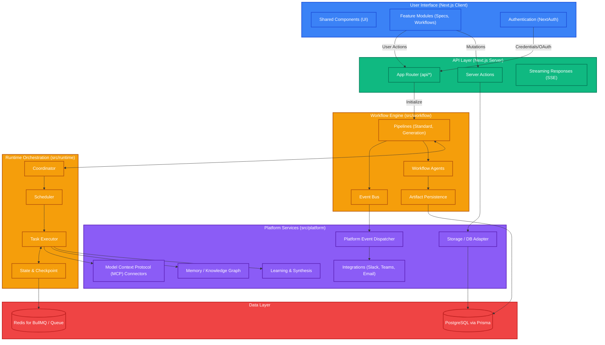

# SpecForge Architecture

The following diagram outlines the high-level architecture of the SpecForge system, including the core Next.js application, workflow engine, runtime orchestration, and platform services.

## Module Responsibilities

- **User Interface (`src/features`, `src/shared`)**: Houses React components, providing the dashboard, AI interaction panels, and artifact viewers.
- **API Layer (`src/app/api`, `src/server`)**: Contains Next.js routes handling intake forms, artifact generation, and returning Server-Sent Events (SSE) for streaming updates.
- **Workflow Engine (`src/workflow`)**: Defines how different generative agents are combined sequentially or parallelly into pipelines. Exposes an event bus for granular step updates.
- **Runtime Orchestration (`src/runtime`)**: Handles actual execution context, scheduling background tasks (potentially via BullMQ), and maintaining checkpoint state for resume capabilities.
- **Platform Services (`src/platform`)**: Provides foundational capabilities such as storage adapters, MCP integrations (file system, GitHub, database integrations), conversational memory graph, and learning synthesizers.
- **Data Layer**: Stores persistent workflow data, user profiles, and generated artifacts via Prisma and PostgreSQL.
